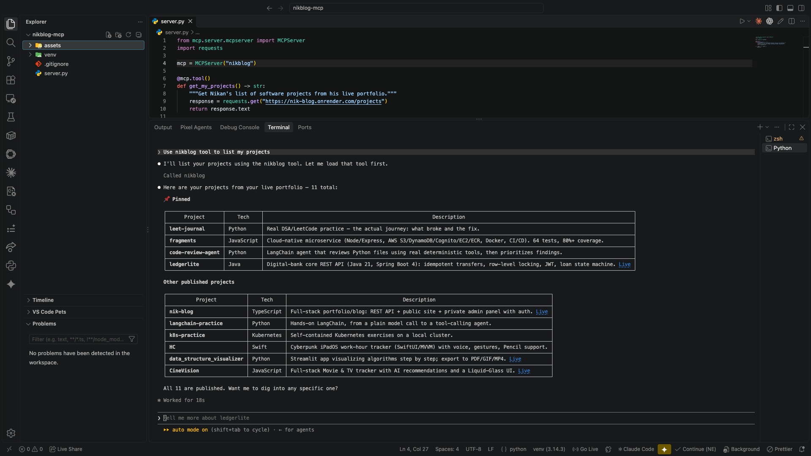

# 00 — What MCP actually is, and why I'm building this

I'd already built two things that look similar to MCP on the surface, but aren't: SkillSet, a custom Claude Skills system, and a LangChain tool-calling agent (Code Review Agent). Two separate résumés asked about MCP directly, and both times I had to write an honest disclaimer that neither project is an actual implementation of the Model Context Protocol. This project closes that gap for real.

## The problem MCP solves

Before a standard existed, every AI application that wanted to connect a model to an external tool or data source had to write custom integration code for that exact pairing. An app built for one tool didn't automatically work with another.

MCP (Model Context Protocol) standardizes that connection. One protocol, so any MCP-compatible client — Claude Desktop, Claude Code, Cursor, anything — can talk to any MCP server, without custom glue code written for that specific pairing.

## How this is different from what I'd already built

- **SkillSet (Claude Skills):** instructions and templates Claude reads and follows, entirely inside Claude's own Skills system. No separate server, nothing sent over a protocol.
- **Code Review Agent (LangChain tools):** a Python function wired directly into the model, inside one script. Only that script can call it — no other AI app can reach it.
- **An MCP server:** a standalone program that exposes its tools through a standard schema. Any MCP-compatible client can connect to it and use those tools, not just the one app I originally wrote it for. That reusability across different AI clients is the actual new thing MCP adds.

## The building blocks

An MCP server can expose three kinds of capabilities:

1. **Tools** — functions the model can call. Conceptually the same idea as LangChain tools, but declared with a standard JSON Schema instead of app-specific code.
2. **Resources** — data the server can hand to a client (a file, an API result), readable without necessarily being "run."
3. **Prompts** — ready-made prompt templates the server can offer.

And a **transport** — how the client and server actually talk. Local servers typically use **stdio**: the client launches the server as a process and communicates over standard input/output. That's what I used here.

For this first project I focused only on tools, since that's the most commonly used piece and the most direct parallel to the tool-calling work I'd already done with LangChain.

## Building the server

The project is `nikblog-mcp` — an MCP server that exposes my live portfolio ([nik-blog](https://github.com/NikanEidi/nik-blog)) as real, callable tools. The core shape of a tool, using the official Python SDK:

```python
from mcp.server.mcpserver import MCPServer
import requests

mcp = MCPServer("nikblog")

@mcp.tool()
def get_my_projects() -> str:
    """Get Nikan's list of software projects from his live portfolio."""
    response = requests.get("https://nik-blog.onrender.com/projects")
    return response.text

if __name__ == "__main__":
    mcp.run()
```

The important detail: the docstring isn't just a comment. It's the exact text the model reads to decide when this tool is relevant. The clearer it is, the better the model picks the right moment to call it.

## A real bug: the SDK had moved on since the tutorials I'd find

My first version imported `from mcp.server.fastmcp import FastMCP`, which is what every quickstart out there shows. It failed immediately:

```
ModuleNotFoundError: No module named 'mcp.server.fastmcp'. This is mcp 2.x, where
FastMCP was renamed to MCPServer (from mcp.server.mcpserver import MCPServer)...
```

The package installed on my machine was `mcp` 2.3.0 — a newer major version than most tutorials assume. Rather than guess at the fix, the right move was reading the actual migration guide and inspecting the installed package directly (`inspect.signature` on the real class) instead of trusting documentation that might not match what's actually on disk. The fix turned out to be small: only the class name and import path changed (`FastMCP` → `MCPServer`, `mcp.server.fastmcp` → `mcp.server.mcpserver`). The decorators (`@mcp.tool()`) and `.run()` stayed identical.

## Connecting it to Claude Code

```bash
claude mcp add --transport stdio nikblog -- /path/to/venv/bin/python /path/to/server.py
```

`claude mcp add` registers the server in Claude Code's local config, scoped to whatever project directory I ran it from. From then on, opening a Claude Code session inside that same project directory launches the server automatically and makes its tools available.

## Verified working

Asked Claude Code "use nikblog tool to list my projects" and got back my real, live project list — 11 projects, pulled straight from the deployed API, nothing hardcoded or guessed:



This is a genuinely callable MCP tool, reachable by any MCP-compatible client, not a script only I can run.

## A second tool: get_my_notes

I added a second tool myself, the same shape as the first, pointed at `GET /notes` instead:

```python
@mcp.tool()
def get_my_notes() -> str:
    """Get Nikan's list of software notes from his live portfolio."""
    response = requests.get("https://nik-blog.onrender.com/notes")
    return response.text
```

Asked Claude Code to list my notes and it correctly pulled all 25, grouped by category, straight from the live site:


