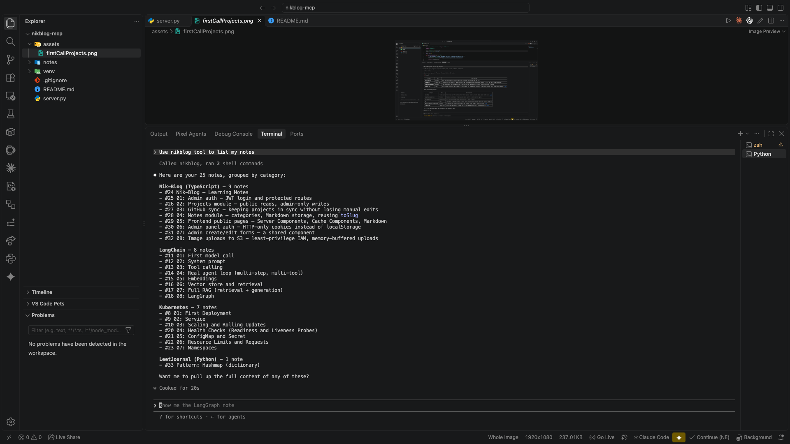

# 01 — A second tool: get_my_notes

Once the first tool (`get_my_projects`) was working, I added a second one myself, same shape, pointed at a different endpoint — `GET /notes` instead of `GET /projects`:

```python
@mcp.tool()
def get_my_notes() -> str:
    """Get Nikan's list of software notes from his live portfolio."""
    response = requests.get("https://nik-blog.onrender.com/notes")
    return response.text
```

Nothing new conceptually — same no-argument tool pattern as before, just a different URL and a docstring describing what it returns this time. That's really the point: once the first tool clicks, adding a second one that does something similar is fast.

Asked Claude Code to list my notes and it correctly pulled all 25, grouped by category, straight from the live site — not anything hardcoded:


