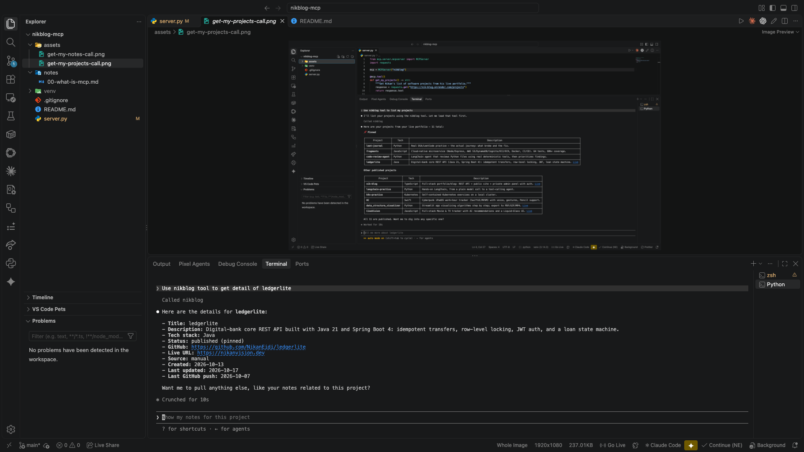

# 02 — A third tool, this one with a parameter

The first two tools take no input. Most real tools need one — the model has to pass something in. In the Python SDK, the tool's parameter type hints are what generate the schema the model sees, so it knows what kind of input this tool expects:

```python
@mcp.tool()
def get_project_by_slug(slug: str) -> str:
    """Get details for one of Nikan's projects by its slug (e.g. 'nik-blog', 'ledgerlite')."""
    response = requests.get(f"https://nik-blog.onrender.com/projects/{slug}")
    return response.text
```

Just declaring `slug: str` in the function signature is enough — the SDK builds a JSON Schema from it saying "this tool takes one string argument called slug." The model works out what value to pass from the conversation itself.

One thing that actually mattered: the examples in the docstring (`'nik-blog', 'ledgerlite'`). Without them, the model could easily guess the wrong format — passing a full project title instead of the URL-safe slug. Showing real examples pointed it at the right shape.

Asked Claude Code "use nikblog tool to get detail of ledgerlite" and it called the tool with `slug="ledgerlite"` and returned the real project record — title, description, tech stack, GitHub link, live URL, status, timestamps, all pulled from the live API:



## Still ahead

None of the three tools handle a bad input (a slug that doesn't exist) or the API being down. That's the next thing to fix — right now a failure would just surface as a raw, unhelpful error.
