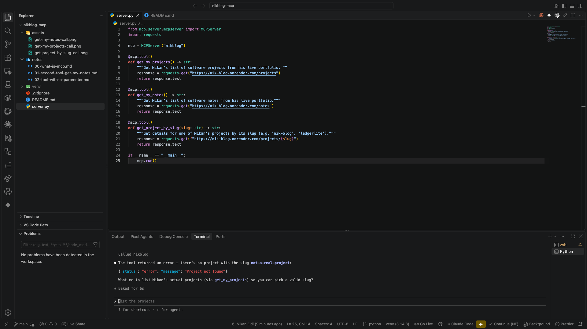

# 03 — Error handling: what happens when a tool call fails

None of the three tools handled failure. Two real failure modes exist for any tool that calls an external API:

1. **A clean "not found" response** — the API is up and responds, just with an error body. Tested this first: asking for a project with a made-up slug returned `{"status": "error", "message": "Project not found"}` as plain text. The model actually handled this fine on its own — read the JSON, understood it, and even offered to call `get_my_projects` to help find a real slug. No code change needed for this case:


2. **The API not responding at all** — down, asleep (cold start), or unreachable. This is the dangerous one. Without a `timeout`, `requests.get()` can hang indefinitely waiting for a response that never comes. Without a `try/except`, a connection failure raises a raw Python exception that could break the tool call ungracefully instead of giving the model something useful to say.

## The fix

Two additions to every tool that makes a network call:

```python
@mcp.tool()
def get_my_projects() -> str:
    """Get Nikan's list of software projects from his live portfolio."""
    try:
        response = requests.get("https://nik-blog.onrender.com/projects", timeout=10)
        return response.text
    except requests.exceptions.RequestException as e:
        return f"Could not reach nik-blog's API right now: {e}"
```

- `timeout=10` caps how long the tool will ever wait.
- `except requests.exceptions.RequestException` catches the whole family of network failures (connection refused, DNS failure, timeout) and turns it into a plain, readable string the model can actually use, instead of an unhandled crash.

Applied the same pattern to all three tools.

## Verified both paths, without touching the real server

Tested with a throwaway script, not the real `server.py`, so nothing in the actual project changed during testing:

- **Normal path:** called `get_my_projects()` and `get_project_by_slug("ledgerlite")` directly — both returned real, live data.
- **Failure path:** pointed a disposable copy of the function at a dead port (`nik-blog.onrender.com:9999`) to simulate the API being unreachable. Instead of hanging or crashing, it returned exactly the message the `except` block promises:

```
Could not reach nik-blog's API right now: HTTPSConnectionPool(host='nik-blog.onrender.com', port=9999):
Max retries exceeded with url: /projects (Caused by ConnectTimeoutError(...))
```

Both failure modes are now handled: a clean API-level error passes through for the model to read, and a transport-level failure (timeout, connection refused) gets caught and turned into something readable instead of crashing.
