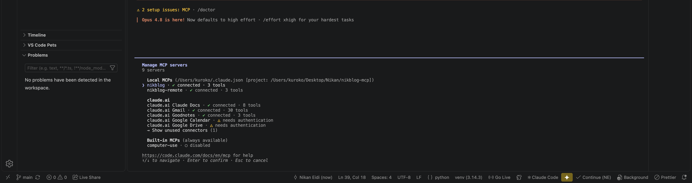
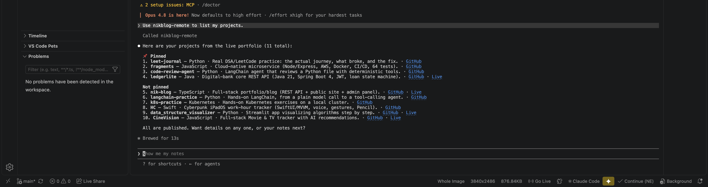

# 04 — Deploying as a remote HTTP server

Everything so far ran locally over **stdio** — Claude Code launches the server as a process on my own machine, so only I can use it. Real production MCP servers are usually hosted and reachable over HTTP, so any client can connect without needing my Python environment set up locally.

## Switching transport based on environment

Render always sets a `PORT` environment variable; my own machine never does. That's enough to pick the right transport automatically, without two separate files:

```python
import os

if __name__ == "__main__":
    port = os.environ.get("PORT")
    if port:
        mcp.run(transport="streamable-http", host="0.0.0.0", port=int(port))
    else:
        mcp.run()
```

Locally: no `PORT` set, so it falls back to stdio, unchanged. On Render: `PORT` is always set, so it runs as an HTTP server instead. `host="0.0.0.0"` matters too — the SDK's default is `127.0.0.1`, which only accepts connections from the same machine. A public service needs to listen on every network interface.

## Getting a requirements.txt

```bash
pip freeze > requirements.txt
```

Render needs this to know what to install — my local `venv` isn't something it can see.

## Verifying locally before deploying

Before trusting this on Render, I ran it locally with a fake `PORT` and hit the `/mcp` endpoint directly:

```bash
PORT=8123 python3 server.py &
curl -i http://localhost:8123/mcp
```

Got back `400 Bad Request` from a bare `curl` call — and that's actually the right result. It proves the server is listening on `/mcp` and handling requests; a plain `curl` just doesn't speak the real MCP handshake a proper client does. A connection refused or a 404 would have meant something was actually wrong; a 400 from the right path means the server itself is fine.

## Deploying

Pushed the repo to GitHub, then created a Render Web Service pointed at it:
- Build command: `pip install -r requirements.txt`
- Start command: `python3 server.py`
- Free instance type

Render set `PORT` automatically — no manual config needed. Build succeeded, and the service came up at `https://nikblog-mcp.onrender.com`.

## Connecting Claude Code to the remote server

```bash
claude mcp add --transport http nikblog-remote https://nikblog-mcp.onrender.com/mcp
```

The real difference from the local setup: no Python path, no venv, just a URL. That's the entire point of hosting it — anyone with an MCP-compatible client can connect to this exact URL, not just me on this machine.

`/mcp` showed `nikblog-remote · ✓ connected · 3 tools`, confirmed alongside the original local `nikblog` server still connected too — both can coexist:



## Verified working, for real, over the network

Asked "use nikblog-remote to list my projects" and got back the real, live list of all 11 projects — pulled by a server now running on Render, not on my laptop:



This is the version of the project that actually proves the point: a standalone MCP server, hosted and reachable by any client, not a script that only works because I happen to be the one running it.
