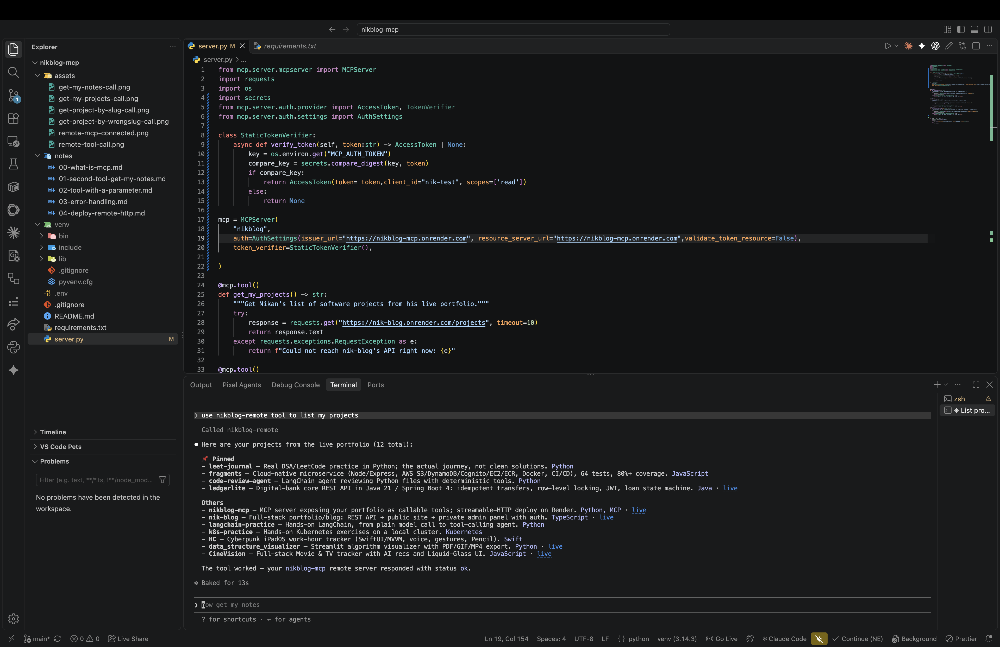

# 05 — Authentication

Up to this point, `nikblog-mcp` was wide open — anyone with the Render URL could call every tool, no questions asked. Fine for a personal demo, but a real job (AssemblyAI's JD literally says "ship MCP auth") expects the server to actually check who's calling it. This note covers adding real bearer-token authentication, not a fake placeholder.

## The building block: `TokenVerifier`

The SDK has a `Protocol` (not a base class — just a required shape) called `TokenVerifier`, with exactly one method:

```python
async def verify_token(self, token: str) -> AccessToken | None:
```

The idea: a client sends a secret string (a "bearer token") in its request headers. This method checks it. Return an `AccessToken` if it's valid, `None` if it isn't — the SDK handles turning a `None` into a real `401 Unauthorized` on its own.

## Writing `StaticTokenVerifier`

For a one-person project, a full OAuth flow (authorization server, client registration, token issuance) is way more than I need — that's built for multi-tenant services where many different users log in. What I actually need is simpler: one fixed secret, like an API key. So I wrote the simplest honest version of `TokenVerifier`:

```python
class StaticTokenVerifier:
    async def verify_token(self, token: str) -> AccessToken | None:
        key = os.environ.get("MCP_AUTH_TOKEN")
        compare_key = secrets.compare_digest(key, token)
        if compare_key:
            return AccessToken(token=token, client_id="nik-test", scopes=['read'])
        else:
            return None
```

Two details that matter here, not just style:

- **`secrets.compare_digest`, not `==`.** A plain `==` on two strings stops comparing at the first mismatched character, so comparing a wrong token takes slightly less time than comparing a right one. That timing difference is small, but it's a real, named attack (timing attack) against secret comparisons. `compare_digest` always takes the same amount of time regardless of where the strings differ.
- **Definition order matters.** Python runs a file top to bottom. I first wrote `StaticTokenVerifier()` as an argument to `MCPServer(...)` with the class defined *below* it in the file — got a `NameError` immediately, because Python hadn't seen the class yet when it tried to use it. Moved the class definition above the `MCPServer(...)` call and it resolved.

## Wiring it into the server

```python
mcp = MCPServer(
    "nikblog",
    auth=AuthSettings(
        issuer_url="https://nikblog-mcp.onrender.com",
        resource_server_url="https://nikblog-mcp.onrender.com",
        validate_token_resource=False,
    ),
    token_verifier=StaticTokenVerifier(),
)
```

`issuer_url` and `resource_server_url` are both required once `auth` is set — I pointed both at my own server since I'm not using a separate identity provider, I'm the one issuing and checking the token.

## A real deprecation warning, caught by actually running it

First version left out `validate_token_resource`. Importing the file still worked, but threw:

```
MCPDeprecationWarning: `AuthSettings.validate_token_resource` is not set...
it will default to True in 3.0 when `resource_server_url` is set.
```

`validate_token_resource` controls whether the SDK itself checks that a token was issued for *this* specific server (its "audience"). My `StaticTokenVerifier` doesn't implement that concept at all — it's a single shared secret, not a per-resource token — so I set it explicitly to `False` rather than silently inheriting whatever the next major SDK version defaults to.

## Testing the auth gate itself, before trusting it

Ran the server locally with a known token and hit `/mcp` three ways:

```bash
curl -X POST http://localhost:8765/mcp -d '{}'                                           # no token
curl -X POST http://localhost:8765/mcp -H "Authorization: Bearer wrong-token" -d '{}'      # wrong token
curl -X POST http://localhost:8765/mcp -H "Authorization: Bearer test-secret-123" -d '{}'  # correct token
```

Results: `401`, `401`, `400`. The first two got rejected before reaching any MCP logic — exactly right. The third got a `400`, not a `200` — and that's also exactly right, for the same reason a bare `curl` always returned `400` even before auth existed: `{}` isn't a real MCP protocol message. A `400` here means the request got *past* the auth check and into the normal protocol handler, which is the proof I actually wanted — auth passes valid tokens through and stops everything else cold.

## Deploying and reconnecting with a header

Added `MCP_AUTH_TOKEN` as an environment variable on the Render service (same secret used locally), pushed, redeployed. Then had to reconnect Claude Code's remote entry with the token attached as a header:

```bash
claude mcp remove nikblog-remote
claude mcp add --transport http nikblog-remote https://nikblog-mcp.onrender.com/mcp \
  --header "Authorization: Bearer <the secret>"
```

Note: authentication only applies to the HTTP transport. The local `nikblog` server (stdio, a subprocess Claude Code launches directly) never goes through this check at all — stdio has no headers to check. That's why it kept working unchanged the whole time.

## Verified working — two different ways, kept honest about which is which

First test just said "use nikblog tool" — the log showed `Called nikblog`, meaning it hit the **local stdio** server, which was never going to prove the new auth code works since stdio skips auth entirely. Not a wasted test, but not the real proof either — worth naming that distinction rather than letting an ambiguous screenshot stand in for a check it didn't actually do.

Re-ran it explicit: "use nikblog-remote tool to list my projects" — log showed `Called nikblog-remote`, and the real response came back with my live project list, over the network, through the token-checked endpoint:



This is the real proof: the deployed server now requires a valid bearer token, and still works end-to-end for a client that has one.
